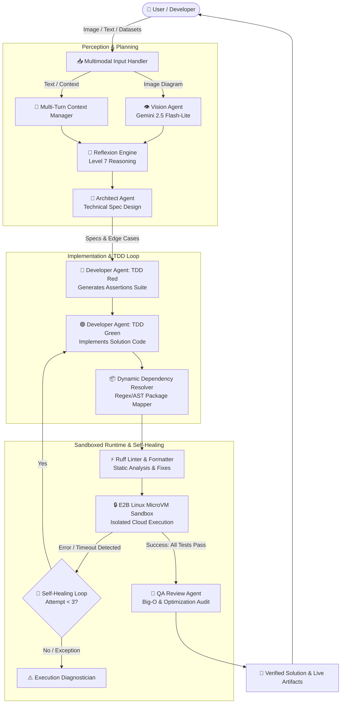

# 🤖 Multimodal AI Coding Agent Team

[](https://www.python.org/downloads/)
[](https://streamlit.io/)
[](https://github.com/agno-agi/agno)
[](https://ai.google.dev/)
[](https://e2b.dev/)
[](https://github.com/astral-sh/ruff)
[](LICENSE)

An autonomous, multi-agent AI software engineering team that converts multimodal inputs (system architecture diagrams, whiteboard sketches, algorithm screenshots, tabular data files, or natural language prompts) into fully tested, production-grade, self-healing Python solutions executed inside isolated cloud microVMs.

Built with **Agno**, **Google Gemini**, **Streamlit**, and **E2B Code Interpreter**.

---

## 📑 Table of Contents

- [Overview](#-overview)
- [System Architecture](#-system-architecture)
- [The 8-Level Agent Capabilities](#-the-8-level-agent-capabilities)
- [Specialized Agent Roles](#-specialized-agent-roles)
- [Repository Structure](#-repository-structure)
- [Getting Started](#-getting-started)
  - [Prerequisites](#prerequisites)
  - [Installation](#installation)
  - [Environment Configuration](#environment-configuration)
  - [Running the Application](#running-the-application)
- [Key Workflows](#-key-workflows)
- [Resume Bullet Points](#-resume-bullet-points)
- [Author & License](#-author--license)

---

## 🌟 Overview

Traditional AI coding assistants rely on a single prompt-response loop that frequently hallucinates, fails on edge cases, and produces code with unverified syntax or broken dependencies.

The **Multimodal AI Coding Agent Team** models an elite engineering department:
- **Multimodal Perception**: Interprets coding challenges directly from images, diagrams, and uploaded files.
- **Pre-Computation Reflexion**: Analyzes constraints, edge cases, and Big-O trade-offs *before* writing code.
- **Test-Driven Development (TDD)**: Synthesizes failing assertion test suites (Red Phase) prior to implementation (Green Phase).
- **Dynamic Dependency JIT**: Automatically resolves third-party packages and provisions them into the sandbox environment.
- **Closed-Loop Self-Healing**: Automatically catches runtime exceptions, tracebacks, or timeouts and self-corrects up to 3 iterative cycles.
- **Automated QA & Linting**: Applies Ruff static analysis and auto-formatting, followed by a senior QA code audit.

---

## 🏛️ System Architecture



---

## ⚡ The 8-Level Agent Capabilities

| Level | Capability | Description |
| :--- | :--- | :--- |
| **Level 1** | **Self-Healing Loop** | Catches execution exceptions, syntax errors, and timeout bounds; passes tracebacks back to the Developer Agent for automated iterative patching (up to 3 recovery cycles). |
| **Level 2** | **Multi-Turn Chat Memory** | Preserves context, past code snapshots, and user feedback across sessions for follow-up refactoring and iterative refinement. |
| **Level 3** | **Cloud Sandbox File I/O** | Direct file upload bridge (`.csv`, `.xlsx`, `.json`, `.txt`) into isolated `/home/user/` sandbox storage for hands-on data analysis tasks. |
| **Level 4** | **Dynamic Dependencies** | Real-time AST/regex parser detects non-standard Python imports and automatically resolves and installs pip packages (e.g., `cv2` → `opencv-python`). |
| **Level 5** | **Multi-Agent Architecture** | Decoupled agent roles (Vision, Architect, Developer, QA, Execution) communicating via structured schemas and typed outputs. |
| **Level 6** | **TDD Red-Green Loop** | Enforces Test-Driven Development by constructing test suites with boundary assertions *before* drafting solution code. |
| **Level 7** | **Reflexion Reasoning** | Structured `<thinking>` protocol that maps edge cases, boundary conditions, algorithmic constraints, and time/space complexity prior to architecture design. |
| **Level 8** | **Ruff Linter Integration** | Executes Ruff within the sandboxed microVM to catch syntax errors, enforce PEP8 standards, and apply auto-formatting fixes. |

---

## 👥 Specialized Agent Roles

1. **👁️ Vision Agent (`Gemini 2.5 Flash-Lite`)**
   - Transcribes algorithm whiteboard drawings, handwritten specifications, and UI screenshots into clean, structured problem descriptions.
2. **📐 Architect Agent (`Gemini 2.5 Flash`)**
   - Acts as a Principal Software Architect. Conducts problem breakdown, identifies edge cases, selects optimal algorithms, and defines formal function signatures and technical specifications without writing raw implementation code.
3. **💻 Developer Agent (`Gemini 2.5 Flash`)**
   - Implements code adhering strictly to the Architect's specification. Operates in two distinct phases: TDD Red (writing comprehensive assertion tests) and TDD Green (writing minimal, performant implementation code).
4. **🔬 QA Agent (`Gemini 2.5 Flash`)**
   - Performs code audits, assesses algorithmic complexity (time and space Big-O), verifies readability, and identifies performance bottlenecks.
5. **⚙️ Execution Agent (`E2B Cloud Sandbox`)**
   - Executes code inside a secure, hardware-isolated Linux microVM, monitors memory and execution time limits (30s timeout), and formats execution logs.

---

## 📁 Repository Structure

```
multimodal_coding_agent_team/
├── app.py                     # Primary entry point for Streamlit application
├── ai_coding_agent_o3.py      # Core agent orchestration and multi-agent workflow
├── requirements.txt           # Python dependencies and version pins
├── .env.example               # Template for API keys and environment variables
├── .gitignore                 # Production-grade git exclusion rules
├── LICENSE                    # MIT License
└── README.md                  # System architecture, documentation, and guides
```

---

## 🚀 Getting Started

### Prerequisites

- **Python 3.10+**
- **Google Gemini API Key** ([Google AI Studio](https://aistudio.google.com/))
- **E2B API Key** ([E2B Cloud](https://e2b.dev/))
- *(Optional)* **OpenAI API Key** ([OpenAI Platform](https://platform.openai.com/))

### Installation

1. **Clone the repository:**
   ```bash
   git clone https://github.com/Vaibhav1376/multimodal-coding-agent-team.git
   cd multimodal-coding-agent-team
   ```

2. **Create and activate a virtual environment:**
   ```bash
   # On macOS/Linux:
   python3 -m venv venv
   source venv/bin/activate

   # On Windows (PowerShell):
   python -m venv venv
   .\venv\Scripts\Activate.ps1
   ```

3. **Install dependencies:**
   ```bash
   pip install -r requirements.txt
   ```

### Environment Configuration

Create a `.env` file in the project root (or configure credentials directly via the Streamlit sidebar):

```bash
cp .env.example .env
```

Populate `.env` with your API credentials:

```ini
GEMINI_API_KEY=your_google_gemini_api_key
E2B_API_KEY=your_e2b_api_key
OPENAI_API_KEY=your_openai_api_key_optional
```

### Running the Application

Launch the Streamlit web dashboard:

```bash
streamlit run app.py
```

The web dashboard will automatically open in your default browser at `http://localhost:8501`.

---

## 🔍 Key Workflows

### 1. Multimodal Algorithm Solver (Image to Code)
1. Upload a screenshot of an algorithm problem, LeetCode challenge, or whiteboard sketch.
2. The **Vision Agent** extracts the requirements, inputs/outputs, and constraints.
3. The **Architect Agent** formulates a technical specification.
4. The **Developer Agent** writes unit tests, followed by the solution.
5. The **Sandbox** installs dynamic packages, runs Ruff linter, and validates the tests.
6. The **QA Agent** returns a comprehensive code quality and complexity review.

### 2. Autonomous Tabular Data Analysis
1. Upload a dataset (`.csv` or `.xlsx`) in the sidebar.
2. Enter your inquiry: *"Analyze the correlation between customer churn and tenure, and plot a distribution."*
3. The agents upload the dataset into `/home/user/` in the E2B microVM.
4. Dependencies such as `pandas`, `seaborn`, or `scikit-learn` are dynamically installed JIT.
5. The script executes securely in the cloud sandbox and delivers verified results.

---

## 💼 Resume Bullet Points

If you are featuring this project on your software engineering or AI resume, here are pre-crafted, high-impact bullet points:

- **Autonomous Multi-Agent AI System:** Engineered a production-grade multi-agent autonomous coding team using **Agno**, **Google Gemini**, and **Streamlit**, organizing 5 specialized agents (Vision, Architect, Developer, QA, Execution) to synthesize and audit software end-to-end.
- **Multimodal Visual Problem Solving:** Architected an image-to-code pipeline leveraging Gemini 2.5 Flash-Lite vision models to parse whiteboard diagrams, architecture schematics, and coding prompts into formal technical specifications.
- **Closed-Loop Self-Healing Runtime:** Designed a self-healing execution loop integrated with **E2B isolated microVM sandboxes**, autonomously capturing runtime tracebacks and timeout exceptions to iteratively refactor and heal code across 3 recovery cycles.
- **TDD & Reflexion Reasoning Engine:** Implemented pre-computation Reflexion analysis to stress-test Big-O limits and edge cases, paired with automated Red-Green Test-Driven Development (TDD) that generates assertion suites prior to code synthesis.
- **Dynamic Package Resolution & Linting:** Built JIT dependency discovery using Python AST and regex mapping alongside automated in-sandbox **Ruff** linter passes for static analysis and PEP8 enforcement.

---

## 👨‍💻 Author & License

- **Author**: [Vaibhav Kakad](https://github.com/Vaibhav1376)
- **License**: Released under the [MIT License](LICENSE).
